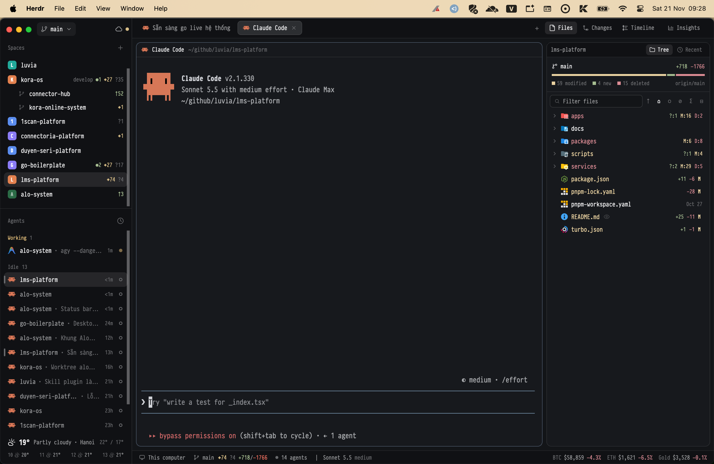

# VNH

A quiet, dense Herdr window for working with coding agents all day. The left sidebar lists your spaces with their git state, then the agents running in them, with a small weather strip at the bottom. The work area is a tab bar, the agent's terminal in a rounded frame, and, when you ask for them, a Files panel, a Changes panel and a Timeline of your prompts on the right. A thin status bar shows the model, effort, usage limits and context of the agent in front of you, whether that is Claude Code, Codex or Antigravity (agy). A space whose agent is working breathes.



## What you see

Window: no title bar (`"titlebar": "none"`), the macOS traffic lights at `[12, 16]`, theme `graphite` (dark) / `paper` (light), 1 px dividers in the theme's `border` color, terminals padded `[14, 12]`. An empty floating `new-chat` block (`role: commands`) sits at the bottom edge for new-chat's command list.

Left to right:

1. **Sidebar**, 268 px, `chrome` background, not resizable (`⌘B` hides it; under 160 px it becomes a rail).
   - **Brand row**, 46 px, drags the window. A branch button (`main ▾`, a pill) that opens a JetBrains-style branch popup, and, in a 40 px block at its right, the Cloudflare deploys icon with a status dot. No line under this row.
   - **Spaces** (top half of the list): a `Spaces` header with a `+`; each row has an 18 px rounded tile with the space's initial on its color, the name, then the working tree of a repo: branch, `↑` `↓`, `⚔` conflicts (red), `●` staged (green), `✚` modified (yellow), `?` untracked. Git worktrees nest under their repo with a branch icon. The selected row has a filled background.
   - **Agents** (bottom half): sections Blocked / Done / Working with counts, then Idle; a row is the agent's icon, the space and the task title, the age, a status dot. Every agent of the shown space has a bar on its left edge (the space's color while it works, gray while idle).
   - **Weather**, 66 px, no frame: `☁ 17° Cloudy · Hanoi   18° / 15°`, then the next four hours.
2. **Work area**, a column.
   - **Tab bar**, 42 px: the tabs, a `+`, then buttons **Files**, **Changes**, **Timeline** (the open one highlighted), and a 104 px **Insights** button at the right end.
   - **Body**, 8 px padding and gap: the **main pane** (frame radius 10, 1 px border; the focused one has an accent frame at 40 %, `#96b2d766`) with a 30 px header (program icon, agent or terminal title, folder, status, split / zoom / close); at its right a **Timeline** panel of your prompts (368 px, 280–900) and a **side panel** (368 px, 280–900, hidden until asked) holding **Files** or **Changes**.
   - **Status bar**, 28 px: `This computer`, the branch with its git counts and the pull request (`#123 ✓ 4m12s approved`), `N agents`, then `| Opus 4.8 high  5% /5h 4h37m  41% /7d 1d2h  69% /ctx`, and BTC / ETH / Gold with their 24 h change at the right.

## How it behaves

- **Agent status.** Working: a 7 px dot that breathes (opacity 0.3 to 1 over 1800 ms) in the Agents list, and the space's tile breathes too (0.35 to 1). Blocked: the status bar adds `· N needs you` in the blocked color. Idle: a ring. Done and idle agents stay in their sections.
- **The status bar follows the agent in front of you.** The model is the agent's own name (`Opus 4.8`, `GPT-5.6-Terra`, `Gemini 3.8 Flash (High)`), the effort after it, dimmer, and not repeated when the name already carries it. `5h` / `7d` are that agent's usage (percent used, time to reset), `ctx` its context. A terminal whose agent hasn't reported yet shows `…`; a shell keeps the last agent. A chat (herdr-chat) shows its own model.
- **Tab bar buttons** toggle one right-hand view at a time: Timeline closes Files / Changes and the reverse. Files, Changes and Timeline share one width.
- **Keys** (`keys/vnh.json`, merged into `keys.json`): `⌘↩` run any command in a new tab (also lists `package.json` scripts), `⌃I` every Claude Code conversation to resume, `⌘E` Files, `⌥A` Changes, `⌘⇧B` Timeline, `⌥S` an AI commit message in Changes, `⌘\` push the branch and its tags without a dialog, `⌘⇧K` a step-by-step walkthrough of a diff, `⌃⇧R` / `⌃⇧U` run and ports.
- **Files** shows git colors per row and a Recent changes section, takes folders dropped from Finder as extra roots, drags a row into a terminal as `@path`, previews Markdown in its own tab. A folder dropped on the Spaces list opens as a space. Worktrees in a project's `.worktrees/` open as spaces by themselves.

## Built from

Layout `layouts/VNH.json` (cloned from Herdr's `main` 0.1.16; its `"preview"` is `layouts/VNH.png`, the picture Settings → Look shows for it; its themes are Herdr's own `graphite` and `paper`, so no theme file is needed), nodes and what they hold:

```
root (row)
├─ sidebar (268px)
│  ├─ brand-row (46px): brand = vnh-chrome (weight 1) | cloudflare-bar = cloudflare-deploys {bar: true} (40px)
│  ├─ sidebar-lists: spaces = vnh-spaces | agents = vnh-agents {replaces: agents}
│  ├─ weather = vnh-weather (66px)
│  └─ worktree-sync = vnh-worktree-sync (0px, draws nothing)
└─ work (column)
   ├─ tabs (42px): vnh-tabs | insights {mode: toolbar} (104px)
   └─ work-inner
      ├─ work-body (row, padding 8, gap 8): main (tab pane, header vnh-pane) | panel (368px, hidden: stack files = vnh-filetree, changes = better-changes {replaces: changes}) | timeline = vnh-prompts (368px)
      └─ status = claude-limits-status (28px)
```

Mods in `mods/` (all `place: none`, the layout places them): `vnh-chrome`, `vnh-spaces`, `vnh-agents`, `vnh-weather`, `vnh-worktree-sync`, `vnh-tabs`, `vnh-pane`, `vnh-filetree` (`vnh-files` is its older twin), `vnh-prompts`, `claude-limits-status`; popups `vnh-git-menu`, `vnh-files-menu`, `vnh-command`, `vnh-sessions`, `vnh-markdown`. They are clones of Herdr's own (`cloned_from` 0.1.16) or of the mods below, with VNH changes. Shipped Herdr mods used as is: `agents`, `changes` (both replaced in their blocks).

Third-party mods, all inside this repo (modified copies, each with its upstream `LICENSE`; sources and changes in `THIRD-PARTY-NOTICES.md`), copied to `mods/<name>/` by `install.sh`:

| mod | from |
|---|---|
| `better-changes` | github.com/munza/herdr-mods (`place` is `"none"`) |
| `file-icons` | Herdr's `files` mod with the Material Icon Theme icons (the SVGs `filetree` and `vnh-filetree` draw) |
| `filetree` | github.com/cybertron288/herdr-mods (keeps the Claude read / write bridge `vnh-filetree` relies on) |
| `cloudflare-deploys` | github.com/SaifHarding/herdr-cloudflare |
| `insights` | github.com/posquit0/herdr-mods (`analytics`) |
| `walkthrough` | github.com/dmazlum/herdr-walkthrough |
| `portal`, `run` | github.com/CodeyPacker/herdr-mods |
| `chat`, `new-chat`, `chat-menu`, `chat-agents`, the chat host and `hc` templates | github.com/ChmaraX/herdr-chat 0.5.0, `vendor/herdr-chat` (the release archive, unmodified, with its SHA256SUMS; its own installer runs from `install.sh`, needs node 20+) |

`overlays/` are whole files copied over files that other installers make, by `install.sh`: `chat/main.js` (the chat publishes its model for the status bar), `chat-agents/agents-base.js` (a breathing dot for working), and the Settings frame (a read-only **Mods** tab, a shortcut editor in **Keyboard**). `bin/` holds the official `jq` 1.8.1 for macOS (arm64, x86_64) and Windows; the installers and the status scripts use it, so the machine needs none (status scripts get a copy in `~/.config/herdr-app/status/bin`). The look settings (size 15, line height 1.4, contrast, `pane_scrollbars: false`: Herdr's scrollbar track drew a line beside agy's output) merge from `keys/settings-vnh.json`; the font family isn't set.

Status bar data, one file per terminal, `~/.cache/herdr-status/<terminal>.json` (`HC_TERMINAL_ID`): `{provider, model, effort, ctx, five, five_reset, seven, seven_reset}`, percent used and unix seconds. Written by `status/write.sh`, called from `claude/statusline.sh` (Claude Code's `statusLine`), `status/agy.sh` (agy's `statusLine`, which keeps agy's own line with `stack_with_default`) and `status/codex.sh` (a Codex lifecycle hook on SessionStart, UserPromptSubmit and Stop that reads the rollout file for effort, context and usage windows). `themes/orca.json` is a Herdr theme with the palette of Claude Code's `custom:orca`; `./install.sh --orca` installs it and sets agy's `colorScheme` to `terminal`.

`herdr` functions used: `spaces`, `agents`, `panes`, `focused`, `terminals`, `theme`, `window`, `keys`, `shared` / `setShared`, `exec`, `hc`, `readTextFile` / `writeTextFile`, `watchFolder`, `openOverlay` / `closeOverlay`, `notify`, `nextCommand`; commands through `run`: `tab.new`, `tab.select`, `tab.close`, `tab.rename`, `space.new`, `space.select`, `space.move`, `pane.focus`, `terminal.pin`, `layout.show` / `layout.hide` / `layout.select` / `layout.resize`, `app.settings`, and the mods' own (`vnh-tabs.git-push`, `vnh-files.refresh`).

What the mods reach, to tell the person before adding:

- **Network:** `claude-limits-status` fetches BTC / ETH / Tether Gold prices from `api.coingecko.com` every 2 minutes; `vnh-weather` finds a location from the **IP address** (`get.geojs.io`) and fetches the forecast from `api.met.no`, falling back to `api.open-meteo.com`; its click opens `yr.no`.
- **Programs:** `git` (spaces, files, branch popup, worktree sync), `gh` (the pull request in the status bar), `sh`, `python3`, `osascript` and `open` (macOS), `du`, `hc`.
- **Files outside their own folder:** `vnh-sessions` and `vnh-prompts` read Claude Code's conversations in `~/.claude/projects` (`vnh-sessions` can also move a conversation to the Trash, through Finder so Put Back works); the status bar reads `~/.cache/herdr-status/` and `~/.cache/claude-statusline/limits.json`; `vnh-filetree` **writes** a project's `.claude/settings.local.json` (`permissions.additionalDirectories` for the folders added to a space) and **types** `/add-dir <folder>` into idle Claude agents of that space; `vnh-command` runs what you type through `$SHELL -ic`.
- **Global configuration `install.sh` changes**, each backed up first: `~/.claude/statusline.sh` (hides Claude's in-terminal status line), `~/.gemini/antigravity-cli/settings.json` (`statusLine`), `~/.codex/hooks.json` (three hooks), `keys.json` (merge); with flags `--layout` the layout and keys, `--karabiner` a `⌘`` ` rule, `--gestures` a LaunchAgent and a small app, `--orca` the theme and agy's color scheme.

## Watch out

- Built for macOS: `osascript`, `open`, the trackpad gestures and Karabiner rule are macOS only; the rest runs elsewhere.
- Needs `jq` (the status scripts) and the mods above installed first, or Herdr shows empty blocks for them.
- The mods are clones of Herdr 0.1.16. On another version run `herdr-app check <mod>` on each and rebuild one from this recipe if it fails.
- herdr-chat's installer also adds a short sub-agents note to the agents' instruction files it finds (`~/.claude/CLAUDE.md`, `~/.codex/AGENTS.md`, Pi's), writes `hc` templates to `~/.config/herdr-core/templates`, and puts its host in `~/.local/share/herdr-chat`. `install.sh` backs up the Herdr home only; for those files run it with care (herdr-chat's `--uninstall` undoes them).
- `install.sh` removes files an older copy of a mod had that the repo's copy doesn't (never `config.json` or `runtime.json`).
- A Herdr or herdr-chat update overwrites an overlaid file: run `./install.sh` again.
- Windows is untested: most mods call `sh`, `osascript` or `open`, and herdr-chat's installer is macOS-only upstream. The author's exact UI is the macOS one.
- Codex holds a new hook until you trust it: open Codex once, run `/hooks` and trust the Herdr status hook. **The Codex side has not been run against a real session** (it was built from the rollout format and tested on a synthetic one), so check the first real session's model, usage and context.
- agy has no custom themes (its `colorScheme` is one of eight names); `terminal` makes it use the terminal's colors, so pick the **orca** theme in Settings → Look for it to match Claude Code.
- Sizes are logical px. A chat's own model reaches the status bar only through `overlays/mods/chat/main.js`; without it the bar keeps showing the last terminal agent while a chat has the focus.
- `install.sh` backs up under `~/.config/herdr-app/.backups/<time>/` (a copy left in `mods/` would be listed as a mod) and overwrites same-named files; the `vnh-*` names are unique, `claude-limits-status` is the one that could clash.

## Done when

- `herdr-app check` passes for each of the 16 mods the layout names, and `layout.switch {"name": "VNH"}` shows a 268 px sidebar, a 42 px tab bar and a 28 px status bar with no empty block.
- In a Claude Code session, after one answer, `~/.cache/herdr-status/<terminal>.json` exists with its model, and the status bar shows that model with its `5h`, `7d` and `ctx`; opening an agy session writes its own file at startup and the bar switches to it when you focus that terminal.
- A space whose agent is working has a tile that fades in and out; an idle space's tile does not.
- `⌘↩` opens the command popup, `⌃I` lists Claude conversations, `⌘E` / `⌥A` / `⌘⇧B` toggle Files, Changes and Timeline, one at a time.
- Settings has a **Mods** tab listing the installed mods in groups (VNH first) with search, and **Keyboard** lists the shortcuts and rebinds one live.
- Running `./install.sh` twice leaves no `.bak` folder in `mods/` and changes no file the second time (agy and Codex report "already installed").
